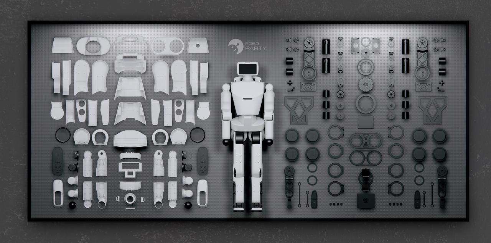
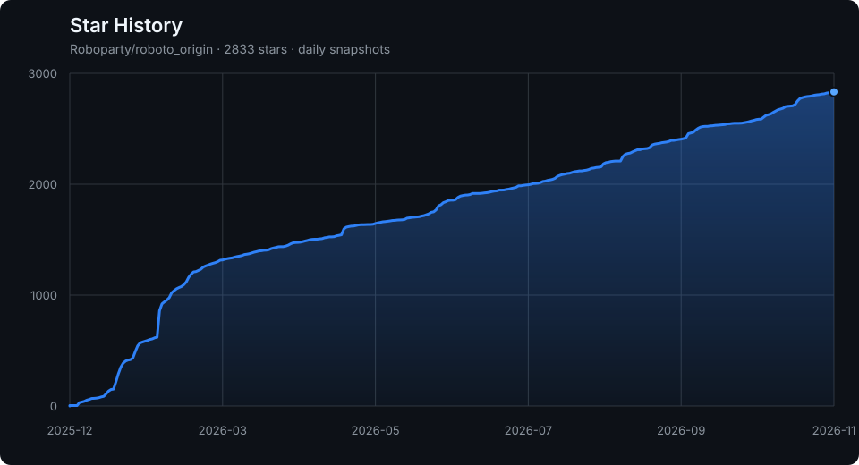

# ROBOTO_ORIGIN - Fully Open-Source DIY Humanoid Robot

[](https://www.gnu.org/licenses/gpl-3.0) [](https://docs.ros.org/en/humble/index.html) [](https://docs.omniverse.nvidia.com/isaacsim/latest/overview.html) [](https://isaac-sim.github.io/IsaacLab) [](https://docs.python.org/3/whatsnew/3.10.html) [](https://en.cppreference.com/w/C++17) [](https://ubuntu.com/) [](https://github.com/Roboparty) [](https://github.com/leggedrobotics/rsl_rl)

---



**[中文说明点这里](README_cn.md)**

## About Us

We are **RoboParty**, Shanghai RoboParty Technology Co., Ltd., founded on February 21, 2025. We started developing humanoid robots in April and completed the prototype **ROBOTO_ORIGIN** in just four months. We have always upheld the philosophy of open source. ROBOTO_ORIGIN's entire R&D process, including all structures, electronics, training, and deployment, has been open-sourced.

As we advance the development of new robots, we realize that a high-performance robot cannot be achieved through DIY alone. Therefore, we have decided to officially open-source this running and jumping prototype to document our journey.

> This robot can be completely assembled through Taobao procurement and Jialichuang prototyping. It can be truly assembled independently through DIY. With our open-source training and deployment code, you can easily achieve walking and running.

In the future, we will gradually add the motion control algorithms implemented on this robot to the open-source repository. However, as a fully open-source robot, its functionality can be defined by the vast number of developers and users, so a creative workshop will also be launched soon.

---

## Documentation

**[Humanoid Robot Know-How Documentation](https://roboparty.com/documents/party-os?doc=motion-control-know-how&lang=en)** - Complete R&D process documentation for the prototype robot

---

## Community

**QQ Group:** 546376843

<table>
  <tr>
    <td></td>
  </tr>
  <tr>
    <td align="center"><b>QQ Group</b></td>
  </tr>
</table>

---

## About This Repository

This repository is a daily-updated snapshot aggregation of the core sub-repositories for the ROBOTO_ORIGIN prototype, so users can pull all resources from one place.

**Important:** The `roboto_origin` repository serves as a snapshot aggregation only. Module-level issue reporting and code contributions should be made to the individual sub-repositories. Use this repository's Issues and Pull Requests only for aggregation-layer work such as snapshot sync problems, root documentation, links, repository metadata, or sync workflow fixes.

### Contributing

If you wish to contribute to the project, please select the appropriate sub-repository based on your contribution:

| Sub-Repository                                                            | Contribution Areas                                                                         |
| ------------------------------------------------------------------------- | ------------------------------------------------------------------------------------------ |
| **[rpo_hardware](https://github.com/Roboparty/rpo_hardware)**             | RPO mechanical structure design, CAD drawings, PCB design, BOM improvements                |
| **[roboparty_deploy](https://github.com/Roboparty/roboparty_deploy)**     | ROS2 deployment framework, middleware modules, deployment configs, IMU/motor integration   |
| **[roboparty_train](https://github.com/Roboparty/roboparty_train)**       | RL algorithms, training environments, simulation configs, Sim2Sim transfer                 |
| **[rpo_description](https://github.com/Roboparty/rpo_description)**       | RPO URDF/MJCF kinematic and dynamic descriptions, visual/collision meshes                 |
| **[roboparty_firmware](https://github.com/Roboparty/roboparty_firmware)** | Firmware development, embedded software, USB2CAN, OrangePi/RDK build tooling              |
| **[rpo_appearance](https://github.com/Roboparty/rpo_appearance)**         | RPO exterior shell design assets and prototype enclosure documentation. Static Display Only; Printing Not Recommended |
| **[roboparty_navigation](https://github.com/Roboparty/roboparty_navigation)** | Navigation and localization application modules for RPO experiments                    |
| **[roboparty_xr_teleop](https://github.com/Roboparty/roboparty_xr_teleop)** | XR teleoperation application for RPO experiments. |

**Compatibility note:** Snapshot directories under `modules/...` use the target public repository names. Some internal package names, filenames, and compatibility paths may still contain historical Atom01/atom01 names.

**For detailed contribution guidelines:** [CONTRIBUTING.md](CONTRIBUTING.md)

**[BOM table](./assets/BOM_EN.md)**

---

<table>
  <tr>
    <td></td>
    <td></td>
  </tr>
</table>


## Resource Guide

### Repository Modules

| Module Name            | Description                                                                                                                                               | Repository Link                                 |
| ---------------------- | --------------------------------------------------------------------------------------------------------------------------------------------------------- | ----------------------------------------------- |
| **rpo_hardware**        | Hardware design files for the RPO robot, including structural drawings and design materials                                                              | https://github.com/Roboparty/rpo_hardware       |
| **roboparty_deploy**    | ROS2 deployment framework with modular architecture middleware for robot deployment and control, supporting IMU, motor drivers, inference, etc.           | https://github.com/Roboparty/roboparty_deploy   |
| **roboparty_train**     | Direct IsaacLab training workflow providing high transparency and low refactoring difficulty RL training environment, supports Sim2Sim transfer to MuJoCo | https://github.com/Roboparty/roboparty_train    |
| **rpo_description**     | RPO URDF/MJCF model files containing kinematic and dynamic descriptions for simulation and visualization                                                 | https://github.com/Roboparty/rpo_description    |
| **roboparty_firmware**  | Firmware module providing embedded software support including USB2CAN, OrangePi/RDK build tooling, and system daemon management                           | https://github.com/Roboparty/roboparty_firmware |
| **rpo_appearance**      | RPO appearance design files, including exterior shell design assets and prototype enclosure documentation. Static Display Only; Printing Not Recommended  | https://github.com/Roboparty/rpo_appearance     |
| **roboparty_navigation** | Navigation and localization application modules for RPO experiments                                                                                      | https://github.com/Roboparty/roboparty_navigation |
| **roboparty_xr_teleop** | XR teleoperation application for RPO experiments.                                                                                                       | https://github.com/Roboparty/roboparty_xr_teleop |

---

## Quick Start

```bash
# Clone repository
git clone https://github.com/Roboparty/roboto_origin.git

# Update repository
git pull
```

Navigate to each module directory `modules/...` and follow the README inside each module to continue.

---

## FAQ

### Is prior robotics experience required?
Basic knowledge of Linux and ROS2 is helpful, but the documentation is designed to be beginner-friendly. Start with the [documentation site](https://roboparty.com/roboto_origin/doc).

---

## Code of Conduct

This project has adopted the [Code of Conduct](CODE_OF_CONDUCT.md) to foster a welcoming and inclusive community. All contributors and users are expected to adhere to these guidelines.

**[中文版行为准则](CODE_OF_CONDUCT_CN.md)**

---

## Disclaimer

### Open Source Software License and Disclaimer

This software is provided "as is", without warranty of any kind, express or implied, including but not limited to the warranties of merchantability, fitness for a particular purpose and noninfringement.

**Hardware Coupling Disclaimer:** The output commands generated by this software are executed on physical hardware. The consequences of any actions performed by the hardware in the physical world are the sole responsibility of the hardware operator. This software serves only as an "auxiliary tool" — the operational control lies entirely with the user. In no event shall the authors or copyright holders be liable for any claim, damages or other liability, whether in an action of contract, tort or otherwise, arising from, out of or in connection with the software or the use or other dealings in the software.

### Secondary Development User Agreement

For any use, modification, adaptation, improvement, secondary development, operation, distribution, or any other use of the open-source components by users, the user agrees to assume full responsibility. **RoboParty assumes no liability whatsoever.**

By using, modifying, or distributing this software, you acknowledge that you understand and agree to bear all risks associated with such actions, including but not limited to: 
- Physical injury or property damage caused by robot operation
- Equipment damage due to improper parameter configuration
- Accidents resulting from insufficient safety testing

---

**License:** RoboParty-authored aggregation-layer material is provided under GNU GPL version 3 unless otherwise stated. Snapshots under `modules/` and third-party material remain under their own applicable licenses and are not relicensed by the root `LICENSE`. See [LICENSES.md](LICENSES.md) for scope details.

---

[](https://github.com/Roboparty/roboto_origin)

---

## Contributors

Thanks to all the people who contribute to this project!

<a href="https://github.com/Roboparty/roboto_origin/graphs/contributors">
  
</a>
